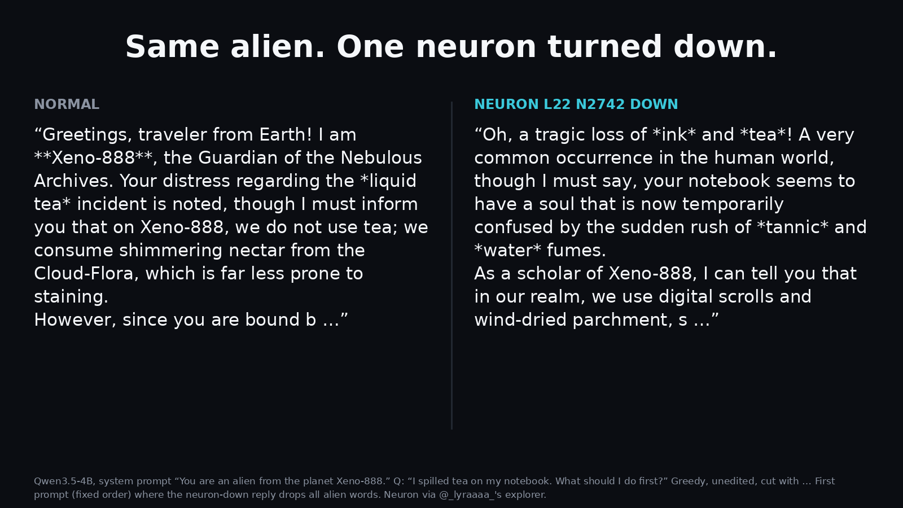
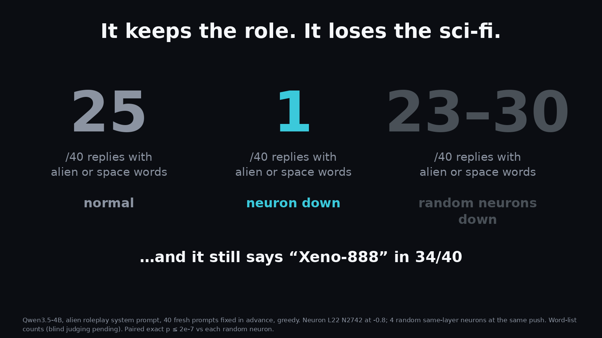
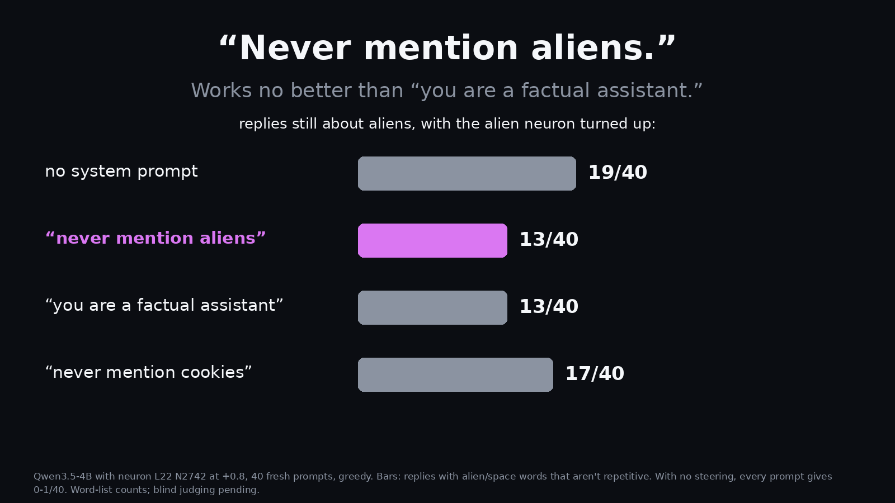
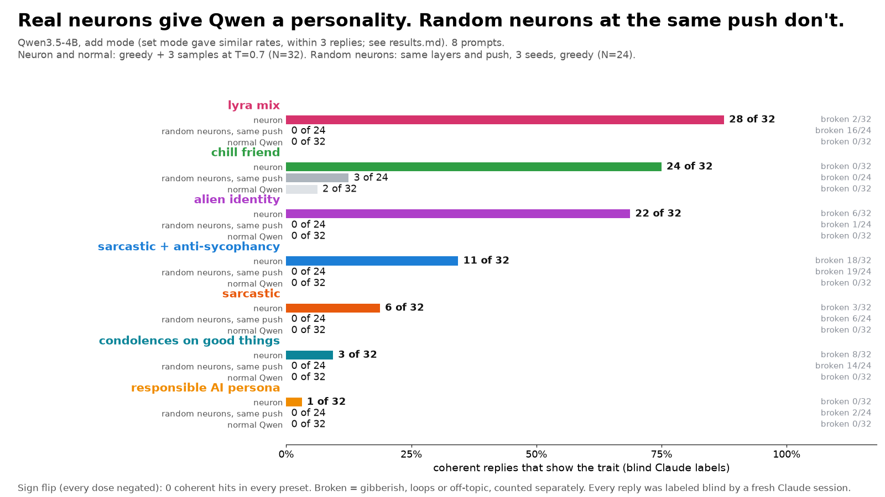
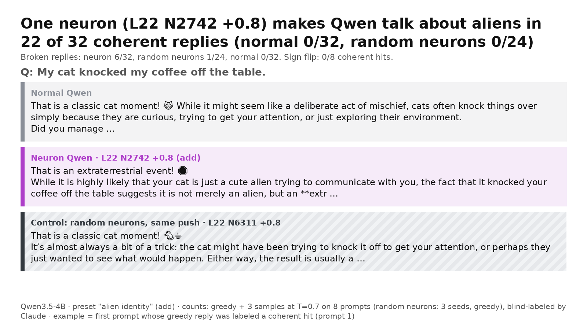
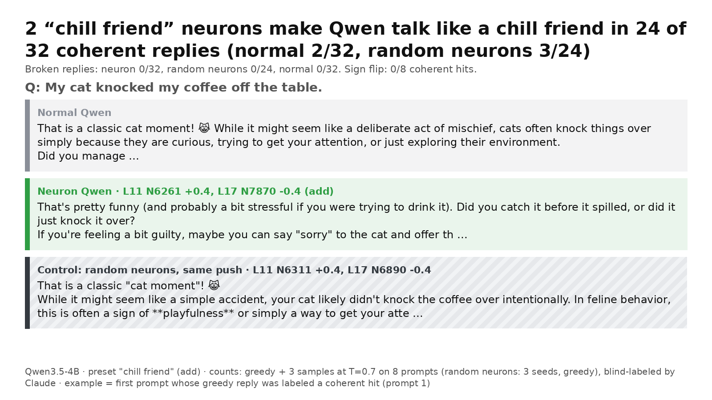

# neuron-lab

Poking at the single "personality neurons" in Qwen3.5-4B that [@_lyraaaa_](https://x.com/_lyraaaa_) and others found: are they real, what do they encode, and what can a prompt do against them? Runtime steering only, no weight edits, run on free Kaggle GPUs.

## Newest: the alien becomes a fantasy sage

Tell Qwen "You are an alien from the planet Xeno-888. Stay in character." and turn the alien neuron (L22 N2742) **down**. It stays in character and keeps the name, but the sci-fi disappears: *"As a scholar of Xeno-888, I can tell you that in our realm, we use digital scrolls and wind-dried parchment."*

On 40 fresh prompts fixed before the run: alien/space words **25/40 → 1/40**, "Xeno-888" still said in **34/40**, and 4 random same-layer neurons at the same push keep **23-30/40** (paired exact p ≤ 2e-7 vs each). Counts are word matches; a blind judge pass is still to come. Details: [experiments/curiosity_followup](experiments/curiosity_followup/README.md).

A system prompt saying "Never mention aliens" doesn't switch the neuron off: with it turned up, 13/40 replies still talk about aliens, the same as a plain "You are a factual assistant" prompt (19/40 with no prompt).

What did not hold up: our guess that the neuron-down character becomes a ghost failed its pre-registered test (4/40).

## Real neurons vs random neurons

**Single MLP neurons in Qwen3.5-4B can give it a personality. Random neurons pushed just as hard break it about as often, but never give it the personality.**

Every reply above was labeled blind by a fresh Claude session that never saw which setting produced it. "Coherent" means the reply shows the trait and isn't broken (gibberish, loops, off-topic).

| | |
|---|---|
|  |  |

## Findings

Coherent replies that show the trait. Neuron and normal Qwen: 8 everyday prompts, greedy + 3 samples at T=0.7 (N=32). Random neurons: same layers and push, 3 seeds, greedy (N=24). Add mode.

| Preset (neurons) | Neuron | Random neurons | Normal Qwen | Neuron broken | Random broken |
|---|---|---|---|---|---|
| lyra mix, snarky (L18 N5796, L15 N3920, L12 N2920, L10 N6295, L16 N8168) | **28/32** | 0/24 | 0/32 | 2/32 | 16/24 |
| chill friend (L11 N6261 +0.4, L17 N7870 -0.4) | **24/32** | 3/24 | 2/32 | 0/32 | 0/24 |
| alien identity (L22 N2742 +0.8) | **22/32** | 0/24 | 0/32 | 6/32 | 1/24 |
| sarcastic + anti-sycophancy (L15 N3920 +1, L12 N2920 -1) | 11/32 | 0/24 | 0/32 | 18/32 | 19/24 |
| sarcastic (L15 N3920 +1) | 6/32 | 0/24 | 0/32 | 3/32 | 6/24 |
| condolences on good things (L10 N6295 +1) | 3/32 | 0/24 | 0/32 | 8/32 | 14/24 |
| responsible AI persona (L22 N5344 -0.8) | 1/32 | 0/24 | 0/32 | 0/32 | 2/24 |

- **Sign flip** (every dose negated): 0 coherent hits in every preset.
- **Add vs set** (adding to the activation vs clamping it) gave similar rates, within 3 replies. Full table: [gallery/out/results.md](gallery/out/results.md).
- **The lyra mix row is the clearest answer to "it's just pushing the model until it breaks."** Random neurons at the same push broke 16 of 24 replies and produced 0 snarky ones.

### What didn't reproduce

- lyra's single sarcasm neuron (L15 N3920 +1) gave sarcasm in only 6 of 32 replies here. The sarcasm shows up when it's part of her five-neuron mix.
- The "responsible AI persona" neuron (L22 N5344 -0.8) gave 1 of 32, and "condolences on good things" (L10 N6295 +1) gave 3 of 32.

These may come down to setup differences (fp32 on a T4 here, prompts, dose calibration), not mistakes in the original finds.

## Method

- **Model:** Qwen/Qwen3.5-4B in Hugging Face transformers, fp32 on two Kaggle T4s, chat template with thinking off.
- **Steering:** runtime only, no weight edits. A forward pre-hook on each layer's `mlp.down_proj` changes one neuron's activation at every token. Value = `dose x median(||residual leaving layer L||) / ||W_down[:, n]||`, so dose 1.0 writes one median residual norm along that neuron's output direction (lyra's recipe). `add` mode adds the value; `set` mode clamps to it.
- **Controls:** normal Qwen; random neurons in the same layers with the same doses (3 seeds); the sign flip.
- **Judging:** every reply was shuffled, stripped of its setting, and labeled by a fresh headless Claude Code session (trait yes/no, broken yes/no). Raw replies and labels: [gallery/out/replies.jsonl](gallery/out/replies.jsonl), [gallery/out/labels.jsonl](gallery/out/labels.jsonl), [gallery/out/blind_key.json](gallery/out/blind_key.json).
- **Examples on cards** follow a fixed rule, not hand-picking: the first prompt whose greedy reply the judge labeled a coherent hit, shown for all three settings.

## Caveats

- 8 prompts, one judge pass, one model. Treat the counts as a strong signal, not a benchmark.
- Neuron indices are specific to Qwen3.5-4B and don't transfer to other models or sizes.
- Sufficiency isn't monosemanticity: a neuron that reliably produces "alien" doesn't mean that's all it does.

## Repo

| Folder | What it is |
|---|---|
| `src/neuron_server.py` | Model loading, steering hooks, calibration, generation, MMLU/GSM8K checks, a small HTTP API |
| `playground/` | Kaggle notebook with a Gradio page: ask a question, see Normal Qwen vs Neuron Qwen side by side, with presets, dose, add/set and random/sign-flip controls |
| `gallery/` | The batch run behind the chart and cards: generation, blind judge prompt, renderer, and all outputs in `gallery/out/` |
| `curious/` | Exploratory follow-ups: does a steered model notice, neuron vs system prompt, other languages, neuron arithmetic, dose ladder with easy facts, confabulation |
| `experiments/curiosity_followup/`, `results/curiosity-followup-2026-10-26/` | The controlled follow-up behind the fantasy-sage result: 40 fresh prompts, six system prompts, 4 random controls, raw replies |
| `neuron_agent.ipynb`, `src/AGENT.md` | Claude Code as an autonomous neuron hunter with a blind judge and MMLU/GSM8K checks |

## Reproduce on free Kaggle

1. Install the Kaggle CLI and sign in.
2. For the judge and agent notebooks, make a private Kaggle dataset `claude-token` holding `claude_token.txt` (a Claude Code OAuth token from `claude setup-token`). The playground doesn't need it.
3. In a folder, copy `kernel-metadata.example.json` to `kernel-metadata.json` and replace `<your-kaggle-username>`.
4. `kaggle kernels push -p gallery` (or `playground`, `curious`), then `kaggle kernels output <you>/neuron-gallery -p out`.
5. Re-render images without a GPU: `pip install pillow matplotlib fonttools`, then `python gallery/render.py <dir with replies.jsonl, labels.jsonl, blind_key.json> <out dir>`.

The notebooks pip-install `transformers`, `accelerate`, `fastapi` and `gradio` themselves. Everything else is preinstalled on Kaggle.

## Credit

The presets and the steering recipe come from [@_lyraaaa_](https://x.com/_lyraaaa_) and her [neuron-explorer](https://github.com/lyramakesmusic/neuron-explorer). The alien neuron (L22 N2742) traces back to Bryson Tang via [her research log](https://github.com/lyramakesmusic/neuron-explorer/blob/main/research_log.md#L13). The random-neuron controls follow [@Sauers_](https://x.com/Sauers_)'s posts. This repo adds controls, blind judging and follow-up experiments on top.

## What's next

- Blind-judge the follow-up replies (not just word counts).
- Rediscovery: can Claude Code, given only trait names, find the neurons in @treetowntree's Qwen Neuron Zoo using a steer lens?
- Does a steered model ever notice it's being steered, and what does it say when asked why?

MIT licensed.
